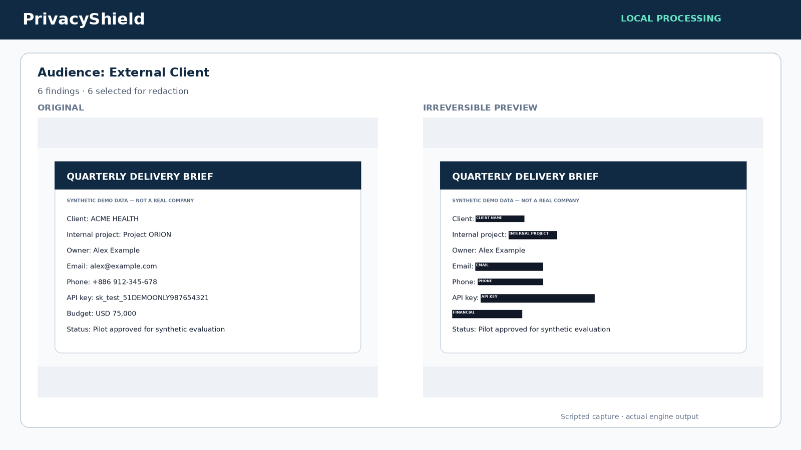

# PrivacyShield

**Create audience-aware, redacted versions of screenshots and documents before sharing—without sending sensitive content to the cloud.**

[](https://www.python.org/)
[](LICENSE)



PrivacyShield is a local-first Stage I prototype for the 2026 ASUS UGen AI League, Workplace AI theme and Battlefield Lightning track. It detects positioned sensitive text, applies a policy for the intended audience, lets a person approve every proposed mask, and exports a new pixel-only PNG/PDF.

> This is a sharing-time document tool, not a system-wide screen-sharing firewall. The demo policy, OCR, and deterministic detectors can miss content. A human must inspect the preview before sharing.

## What works

- PNG/JPG OCR and text/scanned PDF ingestion, processed in memory.
- Deterministic detection of email, phone, API keys/secrets, Taiwan-style ID patterns, selected financial fields, and user-provided project/client dictionaries.
- Different defaults for `Internal Team`, `External Client`, and `Public` audiences.
- Finding table with type, action, reason, OCR confidence, and per-item checkbox.
- Opaque pixel replacement followed by fresh PNG or image-only PDF generation. Original PDF text objects, metadata, annotations, and hidden layers are not copied.
- Explicit errors for unsupported, encrypted, oversized, and over-page-limit documents.
- Fully synthetic demo documents and a reproducible evaluation.

## Quick start

Requirements: Linux, Python 3.11 or 3.12, `tesseract`, and `curl`. No GPU, cloud API, or API key is used.

```bash
git clone https://github.com/chenghan153/PrivacyShield.git
cd PrivacyShield
scripts/setup.sh
scripts/run.sh
```

Open `http://localhost:8501`. On a remote workstation, forward port `8501` through VS Code's **Ports** view; the app intentionally binds only to `127.0.0.1`.

One-line launch after setup:

```bash
scripts/run.sh
```

`scripts/setup.sh` creates `.venv`, installs pinned Python dependencies, stores caches under the project directory, downloads the official Tesseract English data into `.cache/tessdata`, and generates the fictional demo files. It does not use `sudo` or modify global shell settings.

## Demo

Upload either:

- `demo/synthetic_dashboard.png` to exercise local OCR, or
- `demo/synthetic_invoice.pdf` to exercise positioned PDF text extraction.

Use `demo/demo_steps.md` for the complete walkthrough. Every entity, phone number, credential, and amount in these files is fabricated.

## How it works

```text
Browser upload (in memory)
  -> validate type / size / page count
  -> PDF positioned text, or local Tesseract OCR
  -> regex + literal custom dictionaries
  -> audience policy: allow / redact / review
  -> human review checkboxes + before/after preview
  -> burn opaque masks into copied pixels
  -> write a fresh PNG or image-only PDF
```

No input is sent to an external AI API. The app does not intentionally persist uploads; Streamlit keeps upload bytes in process memory for the active session. OCR language data is downloaded only during setup.

## Policy behavior

| Information | Internal Team | External Client | Public |
|---|---|---|---|
| Email / phone | Allow | Redact | Redact |
| API key / secret | Redact | Redact | Redact |
| Internal project | Allow | Redact | Redact |
| Client name | Allow | Review | Redact |
| Financial detail | Review | Redact | Redact |
| Unknown category | Review | Review | Review |

These are explainable demo defaults in `configs/demo_policies.yaml`, not universal security policy.

## Tests and measured results

```bash
scripts/test.sh
.venv/bin/python scripts/evaluate.py
```

Verified on Python 3.11.16 on 2026-10-11:

- `11 passed` in pytest, including actual local OCR of the synthetic PNG.
- 23 synthetic text cases with 24 expected positive labels and 3 explicit negative/ambiguous cases: TP/FP/FN = `24/0/0`.
- Five synthetic one-page PDFs: median `79.04 ms/document` for local analysis plus Public-policy raster export; range `72.79–355.44 ms` on the development workstation.
- The end-to-end test confirms exported PDF bytes contain neither the sample email nor API key, and the new PDF has no searchable text layer.

Read `evaluation/REPORT.md` and `evaluation/results.json` for scope and exact results. The 100% fixture score only shows that known patterns match purpose-built synthetic fixtures. It is **not production accuracy** and does not evaluate broad OCR robustness.

## Security boundaries and limitations

- OCR and regex may miss low-resolution, rotated, handwritten, fragmented, unusual, or adversarial content.
- Dictionary rules only find terms that an operator configures.
- A black-looking preview is not itself a guarantee; use the generated download and keep human review in the workflow.
- Raster export removes recoverable source text at the cost of searchability and accessibility.
- The prototype has no authentication, enterprise policy distribution, audit backend, or malware scanner.
- Local processing reduces document exposure but does not make the host, browser, or operating system inherently secure.
- UGen300/Hailo deployment is a Stage II plan, not a Stage I implementation claim.

## Repository map

```text
app.py                  Streamlit UI
privacyshield/          ingestion, detection, policy, redaction pipeline
configs/                explainable demo policy
tests/                  unit and end-to-end security checks
demo/                   synthetic inputs, actual outputs, demo guide
evaluation/             reproducible synthetic report
scripts/                setup, run, test, evaluation, delivery builders
scripts/build_slides.py proposal deck source generator (local output is not pushed)
scripts/build_video.py  narrated demo source generator (local output is not pushed)
```

Operational notes, course instructions, original competition PDFs, private planning, and submission checklists are deliberately excluded from this public source repository.

## Stage II direction

If selected, the deterministic safety baseline stays authoritative while OCR acceleration and optional local model suggestions are evaluated on the provided ASUS UGen300/Hailo environment. No UGen300, Hailo, latency, or compatibility claim is made until it is measured on that hardware.

## Links

- Repository: <https://github.com/chenghan153/PrivacyShield>
- Demo video: pending YouTube upload by the project owner
- Competition page supplied with the brief: <https://contest.bhuntr.com/tw/39jg9vimiynrhlksze/home/>

## License

MIT. Synthetic demo content is part of this repository and may be reused under the same license.
